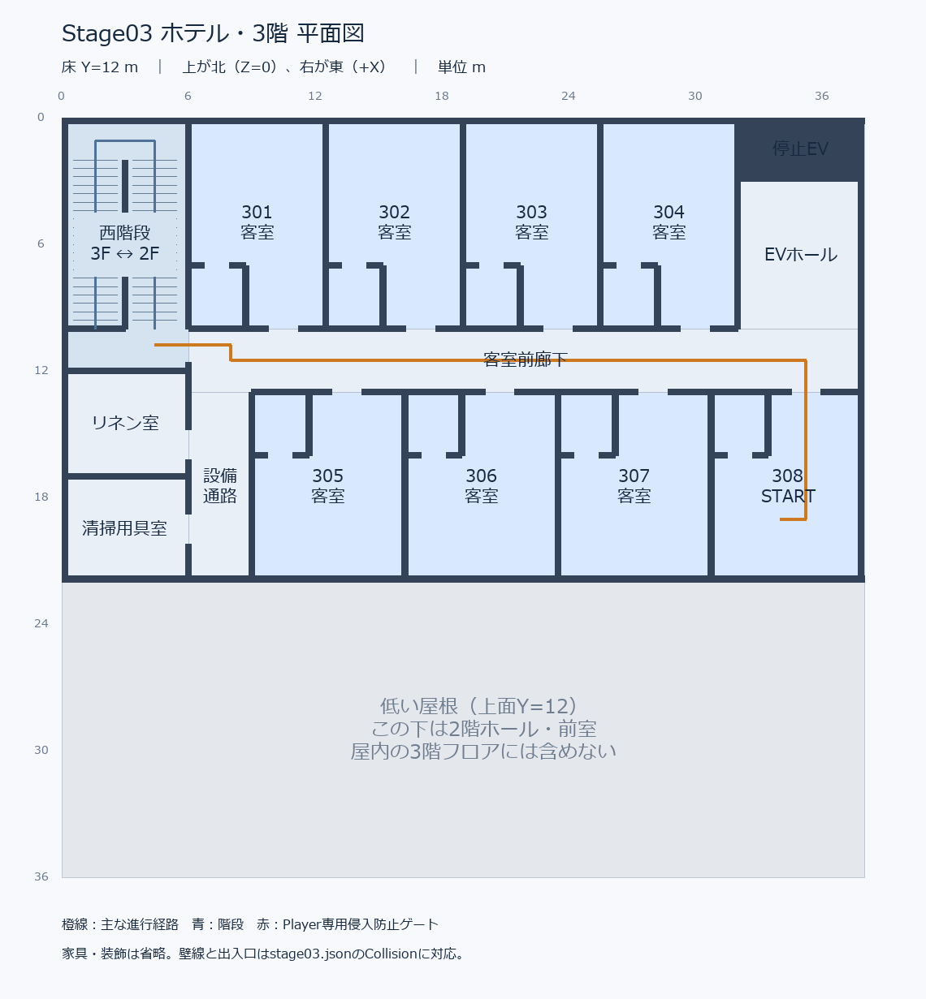

# Stage03 ホテル：3階8客室への拡張

2026-10-16追記：最終脱出シャッターを実装。現在の動作・編集・検証は [stage03-shutter.md](stage03-shutter.md) を参照。

2026-10-15。既存の西階段・宴会施設・ゲーム実装を維持して3階を301～308へ拡張した。
ゲーム座標はX=東、Y=高さ、Z=南、単位m。開始は308の (34,12,19)、北向き。

## 3階の配置と寸法

外形は **38×22m**（旧24×12m）。38×24m程度という目安から、主室を約6×6mに近づけ、不要な奥行きを作らないよう22mに調整した。下部38×36mの宴会棟に収まり、南側14mは2階上部の低い屋根となる。

|区画|範囲 X / Z|区画寸法|
|---|---|---|
|301|6～12.5 / 0～10|6.5×10|
|302|12.5～19 / 0～10|6.5×10|
|303|19～25.5 / 0～10|6.5×10|
|304|25.5～32 / 0～10|6.5×10|
|305|9～16.25 / 13～22|7.25×9|
|306|16.25～23.5 / 13～22|7.25×9|
|307|23.5～30.75 / 13～22|7.25×9|
|308・開始室|30.75～38 / 13～22|7.25×9|
|中央廊下|6～38 / 10～13|幅3、長さ32|
|西階段|0～6 / 0～12|従来通り、3階↔2階|
|設備通路|6～9 / 13～22|幅3|
|リネン室|0～6 / 12～17|6×5|
|清掃用具室|0～6 / 17～22|6×5|
|EVホール|32～38 / 3～10|6×7|
|閉鎖EV設備|32～38 / 0～3|停止中、進入・移動不可|

客室寸法は壁・入口・水回り骨組みを含む区画寸法。主室の有効寸法は北側が概ね6.2×6.55、南側が概ね6.8～6.95×5.55。廊下側3mを入口と水回り区画に配分し、内部区画も主室から出入りできる。家具・水回り機器は未制作。

全8室に独立した廊下側開口（幅1.4m・高さ2.6m）があり、客室間の直接接続はない。水回り開口幅1.2m、室内・廊下の有効天井高3m。各室外壁には幅2.6×高さ1.7m、腰高0.9mの固定窓仮形状を設置。窓は不透明の仮材料とColliderで閉鎖し、窓枠・腰壁・まぐさ・壁柱を後から編集できる。

## 308から西階段への経路

**(34,12,19)** → 308内を北東へ → 出入口 **(35.25,12,13)** → 廊下 **(35.25,12,11.5)** → 西へ約27m → **(8,12,11.5)** → 階段入口 **(6,12,10.8)** → 上踊り場 **(4.4,12,10.8)** → 折り返し階段（中間Y=9）→ 2階階段ロビー **(9,6,10.8)**。

308は西階段から最も遠い東端の南側客室。壁で開始地点から階段への直視を遮る。EVホールと各客室の探索は任意で、廊下を西へ進むだけでも階段に到達できる。設備通路の終端には清掃用具室があり、用途のない行き止まりは作っていない。

以降は従来通り：2階前室 → 宴会ホール → 東廊下 → 東階段 → 1階東廊下 → 宴会ホール → 西シャッター → 出口通路 → 防火扉 → 屋外Goal **(-16,0,18)**。

## 平面図と実メッシュ確認画像



SVGは `docs/stage03-floor-plans/f3.svg`。1階・2階の図も再生成し、変更前と同一の内容。橙線は主経路、自動テストは全室を探索する寄り道を含む。

Blender Workbenchで保存.blendの実メッシュを描画した画像は `generated/hotel-f3-review/`。

|ファイル|内容|
|---|---|
|03-f3-top.png|屋根なし3階上面。北が上・東が右|
|06-exterior.png|ホテル全体の外観、3階窓と一体的な段差屋根|
|01-f1-top.png / 02-f2-top.png|1階・2階の上面|
|04-top-roof.png / 05-west-side.png|屋根配置・西側立面|
|07-section-z18.png|全体断面|
|08-west-stair-section.png / 09-east-stair-section.png|両階段断面|
|before-structure.json / after-structure.json|実メッシュ範囲と構造検証|

確認用カメラ・切断形状・コンポジタは保存.blendやゲーム出力に含めない。

## 床・天井・外形と既存機能の保持

|対象|配置|
|---|---|
|1階床|従来通り、上面Y=0、38×36|
|2階床／1階天井|従来通り、上面6・下面5.65、東階段開口のみ|
|3階床／2階天井|上面12・下面11.65、38×22から西階段開口6×10を除く。面積776m²|
|残りの2階屋根|上面12・下面11.65、X=0～38 / Z=22～36、面積532m²|
|3階屋根／天井|上面15.35・下面15、38×22|
|西階段|従来通り、Y=12→9→6、各20段の2フライト|
|東階段|従来通り、Y=6→3→0、各20段の2フライト|

スラブ厚0.35。3階床と低い屋根が2階天井を分担し、重複や隙間を作らない。3階内壁は床Y=12から天井下面15へ接続。建物外形に張り出す床や壁はない。

変更前JSONと比較し、1階・2階・両階段・屋外経路のCollider、6 Spawn、Goal、シャッター・ボタン・防火扉の配置一致を検査した。ゲームシステム・シーン登録・他ステージは変更していない。敵/SpawnGroup/武器/イベント/EV動作は追加していない。

## バックアップと変更ファイル

変更前バックアップ：`generated/hotel-f3-before-20261015/`。Stage03一式、生成・平面図・検証スクリプト、Exporter、テスト、旧報告書を保存。`tracked-files.json` は作業開始前の追跡ファイルSHA256。過去のバックアップも保持。

- `resources/levels/stage03/stage03.blend / .gltf / .bin / .json`：形状・開始位置・外形。
- `resources/levels/stage03/stage03-layout.json`：寸法・出入口・用途・接続。
- `Tools/blender/create_stage03.py`：8客室・設備室・窓・308開始・F3編集表示の再生成。
- `Tools/blender/create_stage03_floor_plans.py`：新しい平面図ラベルと主経路。
- `Tools/blender/review_stage03_architecture.py`：拡張範囲・天井・保持検証・実メッシュ描画。
- `Tools/blender/test_stage03.py`：8室・開始位置・窓・F3_Edit・再書き出し。
- `tests/HotelStageChecks.h`：全室・水回り・設備室・閉鎖EV・壁・天井・開始遮蔽・全経路。
- `tests/HotelStageRuntimeTests.h`：実GameSceneの経路・Restart・7地点D3D12描画。
- `Tools/test-hotel-runtime.ps1`：構成ごとに経路CSVも保存。
- `docs/stage03-floor-plans/f3.png / f3.svg`：新平面図。
- `docs/hotel-stage.md`：本報告。

`yanengine_level_exporter.py` は既存v1.9を使用し変更なし。

## Blender編集と再検証

編集元は `resources/levels/stage03/stage03.blend`。Collection `F1_Escape / F2_Middle / F3_Start / Building_Roof / Outdoor` と各階の `Floors / Walls / Envelope / Stairs / Colliders / Markers` を維持。

**View Layer `F3_Edit`** で3階だけを屋根なし表示。通常の全体表示・書き出しは `ViewLayer` を選択。3階屋根は `Building_Roof`、階段は降り始める階に所属。上下の確認では両階を表示する。

保存後にExporterでValidate → Export。Stage ID=`stage03`、Project Root=`//../../../`、Output Directory=`resources/levels/stage03`。Gravity、床とSmoothRampのWalkableを維持する。ゲームはDebugのOpen Hotel (Stage03)、またはDebug/Release実行ファイルの `--hotel`。

手編集の通常反映はExporterを使う。生成スクリプトの再実行は手編集を置換する。平面図の更新時は用途表も合わせて更新する。

リポジトリ直下（CG2_Setup.slnの場所）で実行：

```powershell
$blender = 'C:\Program Files\Blender Foundation\Blender 5.0\blender.exe'
& $blender --background --factory-startup --python-exit-code 1 --python Tools/blender/create_stage03.py
& $blender --background --factory-startup --python-exit-code 1 --python Tools/blender/review_stage03_architecture.py
& $blender --background --factory-startup --python-exit-code 1 --python Tools/blender/test_stage03.py
python Tools/blender/create_stage03_floor_plans.py # Pillowが必要
& .\Tools\test-hotel-stage.ps1
& .\Tools\build.ps1 -Configuration Debug
& .\Tools\build.ps1 -Configuration Release
& .\Tools\test-hotel-runtime.ps1 -Configuration Debug
& .\Tools\test-hotel-runtime.ps1 -Configuration Release
```

この環境ではBlender 5.0.1を使用。元の5.2形式.blendはバックアップに保持。アセット正規化やPDBサーバーが制限環境で拒否される場合は、同じテスト・ビルドを通常の開発環境アクセスで実行する。

## 検証と次回の調整

最終結果は `generated/hotel-f3-review/verification.txt`。実ゲーム画像・経路CSVは `generated/hotel-tests/Debug / Release/` に保存。自動テストはFPSMotionと実GameSceneのMovePlayerをフレームごとに実行する。

|検証|結果|
|---|---|
|308開始・全8室／水回り・リネン／清掃室・EVホール|成功。閉鎖EVへの進入も阻止|
|全経路・両階段・屋外Goal|成功。30／60／144 FPSで下り・上りを往復|
|客室壁・外壁・天井・床・屋根|成功。壁抜け、床欠損、スラブ重複を検査|
|既存の下階・階段・Spawn・出口設備・Goal|変更前JSONとの一致確認に成功|
|Debug／Releaseビルド|両方成功、警告0・エラー0|
|Debug／Release実ゲーム|両方成功。53経由点、7地点のD3D12画像、308へRestart|
|他ステージ・既存システム|Stage01、Debug Showroomの初期化成功。対象外1300追跡ファイルのSHA256一致|
|Blender編集・再出力・実メッシュ画像|成功。保存データとJSON一致、隔離プロジェクトへ編集再出力、9画像を目視確認|

**キーボードによる手動通しプレイは未検証**。次回は308から入口を見つける分かりやすさ、廊下32mの距離感、入口幅、階段のカメラと手すり、EV停止表示、窓材料を手動調整するとよい。家具・装飾・本格照明・敵/武器/イベントは別工程。
