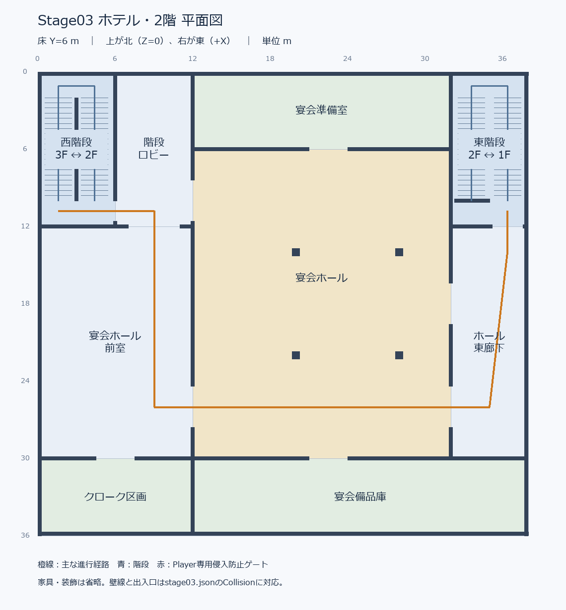
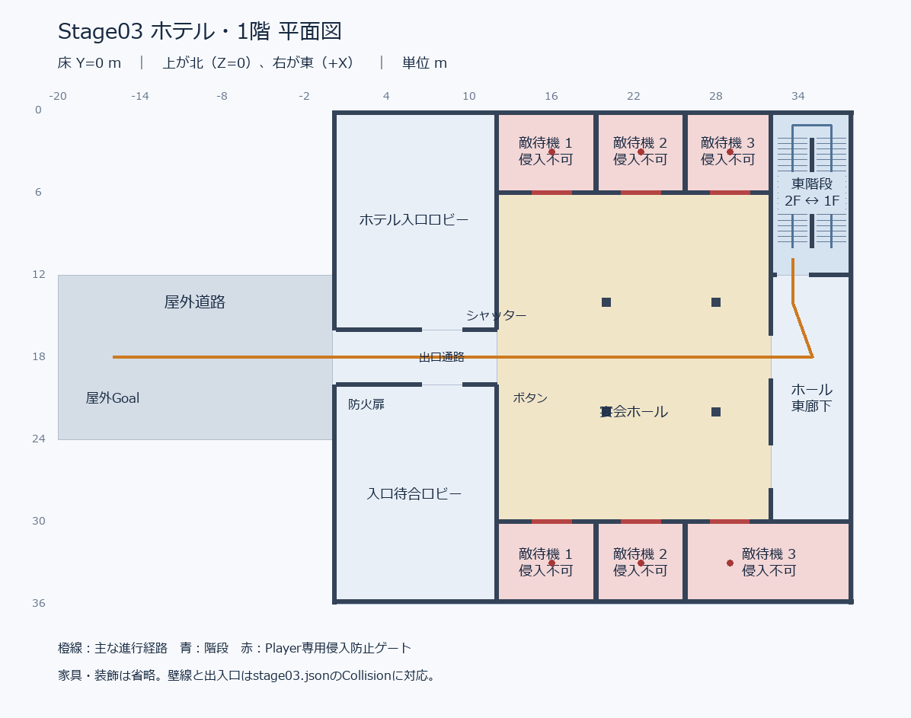

# Stage03 ホテル：内装・接続構造の見直し

2026-10-13。従来の進行順序を残し、**宴会ホール2層＋3室の客室棟**に整理した。
家具・装飾・イベントは追加していない。ゲーム座標X=横、Y=高さ、Z=奥行き、1単位=1m。

## バックアップと調査

変更前のホテルを `generated/hotel-interior-before/stage03/` に保存した。
.blend / .gltf / .bin / .jsonに加え、生成・確認スクリプト、検証コード、旧報告書も同じバックアップに保存。
`tracked-files.json` は作業開始時の全追跡ファイルのSHA256。既存の未コミット状態を含む。
以前の `generated/hotel-architecture-before` も保持している。

実際の.blendのメッシュ範囲・床スラブ、glTFのメッシュとJSONのCollider、生成処理を突き合わせた。
旧配置の接続は次の通りだった。

- 3階：301～306 → 幅6の中央廊下 → 西側を長く回る廊下 → 24mの直線階段。
- 2階：西側廊下 → 大広間 → 南側廊下 → 東側の24m直線階段。
- 1階：北東の狭い入口通路 → 大広間 → 西シャッター → 出口通路 → 防火扉 → 屋外。

旧.blendの上面・側面と生成名から、以下を問題として特定した。

|変更前の空間|問題|今回の処理|
|---|---|---|
|3階304～306と巨大な南側客室床|床の余白を埋めるために追加した客室。今回必要な3室を超える|撤去。南側を2階上部の低い屋根へ変更|
|3階東側のサービス室2区画、長い西廊下|用途が定まらず、客室から階段まで不自然に遠い|撤去。3階屋内を24×12の客室棟へ縮小|
|西・東の24m直線階段区画|大きな床開口と階段脇・踊り場の余白|各6×12の折り返し階段室へ変更|
|2階北側のサービス室3区画|用途不明の同形区画|宴会準備室1室へ統合。ホールから出入り|
|2階南側の外周廊下|ホールの外を回れて、進行の順序が曖昧|宴会備品庫へ変更。ホール経由で東階段へ進む|
|2階西側の余白|長い廊下と階段周りが連続する曖昧な空間|階段ロビー、宴会前室、クローク区画として接続|
|1階西側の細分化されたサービス区画・隙間|細い区画と広い余白が混在|間仕切りを統合。入口ロビー・待合ロビーを出口通路の両側へ接続|
|1階敵待機室の間の細い隙間|二重の側壁と用途のない閉鎖空間|共有壁で6室を連続配置。隙間を撤去|
|旧北東の幅2入口通路、東側の長い袋小路|入口が狭く、終端に目的がない|幅6の東廊下へ変更。ホールに2入口、南端は待機室／備品庫へ統合|
|全階共通の42×36×18箱|3階にも不要な床・部屋が残る|下部38×36、客室棟24×12、屋根12／15.35の一体的な段差形状へ整理|

用途不明の空間を増やす目的で新しい客室を追加していない。
クローク・準備室・備品庫は、既存の余白・サービス室・南通路を統合・転用したもの。
1階ロビーも旧西側区画の統合。現時点では用途を示す空の部屋で、設備や家具はない。

## 各階の平面図と用途・接続

図はゲーム座標に合わせて上が北（Z=0）、右が東（+X）。
壁・開口は出力済みJSONのCollisionから描画し、床区画は `stage03-layout.json` の用途表に対応。
PNGと編集可能なSVGを用意した。Blenderの実メッシュ上面図も別途確認した。

### 3階


|空間|用途・広さの目安|接続先|
|---|---|---|
|Room301|開始客室、6×8、開始位置(9,12,4)|客室前廊下|
|Room302 / 303|空の客室、各6×8|客室前廊下|
|GuestCorridor|幅4の客室前廊下|301～303、西階段|
|WestStair|6×12の階段室。踊り場を挟んで2階へ|3階廊下、2階階段ロビー|
|灰色の範囲|2階上部の低い屋根。3階の屋内フロアに含めない|室内から出入り不可|

3階屋内はX=0～24、Z=0～12のみ。客室の有効天井高さは3m。
廊下から客室の出入口と階段入口を把握でき、不要な反対側客室・サービス通路はない。

### 2階



|空間|用途|接続先|
|---|---|---|
|西階段|3階からの到着|階段ロビー|
|階段ロビー|客室棟から宴会施設への入口|西階段、前室、ホール西北入口|
|宴会ホール前室|入場前の待合・集合スペース|階段ロビー、ホール西南入口、クローク|
|クローク区画|宴会利用者の手荷物預かり用の空区画|前室|
|宴会準備室|旧北側サービス3室を統合|ホール北入口|
|宴会ホール|中間階の戦闘空間。20×24|西側2入口、東側2入口、準備室、備品庫|
|宴会備品庫|旧南通路を転用した裏方区画|ホール南入口|
|東廊下|幅6。次の階段へつながる廊下|ホール東側2入口、東階段|
|東階段|1階へ降りる折り返し階段|2階東廊下、1階東廊下|

西の到着側と東の出発側はホールを挟んで分離。外周の廊下だけでホールを迂回する経路はない。
準備室・備品庫・クロークは用途のある付属区画として1つの出入口を持つ。

### 1階



|空間|用途|接続先|
|---|---|---|
|東階段|2階からの到着|東廊下|
|ホール東廊下|到着側の入口通路|東階段、ホール東側2入口|
|宴会ホール|独立した1階の戦闘空間。20×24|東廊下、西シャッター、上下の敵専用6室|
|敵専用Upper1～3 / Lower1～3|ホテル裏方・物品庫を想定した待機区画。Player侵入不可|それぞれホールへ幅3の直進出口|
|ホテル入口ロビー|旧西北側の細分化区画を統合|出口通路の北側開口|
|入口待合ロビー|旧西南側区画を統合|出口通路の南側開口|
|出口通路|幅4、長さ12。シャッター通過後の経路|ホール、両ロビー、防火扉、屋外|
|屋外道路|西へ20の短い道路|ホテル出口、屋外Goal|

ロビーは出口通路から入れるため、壁に囲まれた使えない空洞ではない。
敵待機室は仮カーテンで奥を隠し、Player専用Colliderで侵入を防ぐ。
敵は既存のCollision判定でそのままホールへ直進退出できる。

## 主な移動経路・イベント用配置

301 **(9,12,4)** → 客室前廊下 **(9,12,10)** → 西階段上踊り場 **(4.4,12,10.8)** →
中間踊り場Y=9 → 2階階段ロビー **(9,6,10.8)** → 前室 →
中間階ホール西入口 **(12,6,26)** → ホール → 東入口 **(32,6,26)** →
東廊下 → 東階段上踊り場 **(36.4,6,10.8)** → 中間踊り場Y=3 →
1階東廊下 **(33.6,0,14)** → 1階ホール **(30,0,18)** →
シャッター **(12,0,18)** → 出口通路 → 防火扉 → 屋外 → **Goal (-16,0,18)**。

|仮設備・出現地点|位置／状態|
|---|---|
|`SP_F1_Upper_01 / 02 / 03`|(16,0,3) / (22.5,0,3) / (29,0,3)、出口Z=6から+Zへ|
|`SP_F1_Lower_01 / 02 / 03`|(16,0,33) / (22.5,0,33) / (29,0,33)、出口Z=30から-Zへ|
|`Hotel_Shutter_Raised_Placeholder`|(12,3.6,18)、下端3.1で通行可能|
|`Hotel_Shutter_Button_Placeholder`|(12.25,1.25,21)|
|`Hotel_FireDoor_Open_Placeholder`|(2.9,1.6,19.8)、壁沿いに開いた状態。閉鎖位置はX=1、Z=18|
|`Goal_Outdoor_CityConnection`|(-16,1.5,18)、サイズ(3,3,4)|
|白い仮目印|(-24,2,18)、サイズ(2,4,2)|

修正前後のJSON比較で、6出現地点とシャッター・ボタン・防火扉・出口ヘッダーのTransform／Colliderが完全一致することを確認。
Spawn Trigger / Spawn Groupは空。敵出現・シャッター操作・防火扉閉鎖・無限Spawn・市街地遷移は未実装。

## 床・天井・階段・外形

|対象|構造|
|---|---|
|1階床|Y=0、38×36、面積1368|
|2階床／1階天井|上面6、下面5.65、東階段開口32～38 / Z=0～10を除く。面積1308|
|3階床／2階天井|上面12、下面11.65。24×12の客室棟内で西階段開口0～6 / Z=0～10を除く。面積228|
|低い屋根／残りの2階天井|上面12、下面11.65。客室棟外の1080を覆う|
|客室棟屋根／3階天井|上面15.35、下面15。24×12|
|西階段|Y=12 → 9 → 6。2フライト、各20段|
|東階段|Y=6 → 3 → 0。2フライト、各20段|
|各フライト|幅2.3、水平長8、高低差3。見た目は踏面0.4／蹴上げ0.15、Collisionは滑らかな坂|

スラブ厚は全て0.35。床と屋根を組み合わせた2階天井に重複や余計な開口はない。
2階・3階の屋内外壁は下部外形の内側に収まり、張り出す床はない。
1階と2階のホールと4柱は同じ位置で上下に揃える。
階段中央壁と上踊り場のガードで、隣の下側フライトへ意図せず落ちる開口も遮る。
中間踊り場の上に残っていた到達不能な上階床も撤去し、階段の先に不自然な床が張り出す状態を解消した。
外形は下部の宴会棟に小さな客室棟が載るホテルの骨組み。窓・意匠・家具は後工程。

## Blender編集・ゲームへの反映

編集ファイル：`resources/levels/stage03/stage03.blend`。
既存の `Tools/blender/yanengine_level_exporter.py` v1.9を使用。

- `F1_Escape`：1階床、ロビー・ホール壁、敵待機室、出口設備。
- `F2_Middle`：2階床、前室・付属区画、東階段。
- `F3_Start`：3階客室・廊下、西階段。
- `Building_Roof`：低い屋根2タイル、客室棟屋根1枚。
- `Outdoor`：道路・Goal・白い目印。

各階に `Floors / Walls / Envelope / Stairs / Colliders / Markers` を分離。
親Collectionの目アイコンで階を個別に表示・非表示できる。
階段は降り始める階に属するので、上下階の接続確認では両階を表示する。
床や階段を変更する場合、上階床＝下階天井・階段開口・踊り場・SmoothRampも合わせて調整する。

1. 対象を編集しCtrl+S。
2. Stage ID=`stage03`、Project Root=`//../../../`、Output Directory=`resources/levels/stage03`を確認。
3. Player GravityをON、床／踊り場／SmoothRampのWalkableをONのままにする。
4. Validate → Export。ゲームをRestart（Releaseでは再起動）。

`stage03-layout.json` と.blendの `hotel_zones` は用途・接続・平面図の補助情報で、ゲームのデータ形式を拡張しない。
手編集で用途や間取りを変えた場合は、平面図も更新するならこの用途表を合わせて更新する。
ゲームへの形状反映は通常のExporterだけで行える。
生成スクリプトの再実行はStage03を作り直すため、手編集後の通常反映にはExporterを使う。

## 読み込み・再検証

- Debug：FPS Controls → **Open Hotel (Stage03)**。
- Debug / Release：`CG2_Setup.exe --hotel`。
- シーンID `Stage03`、読み込み先 `resources/levels/stage03/stage03.json`。

リポジトリ（CG2_Setup.slnのある場所）で実行：

```powershell
& '..\generated\outputs\Debug\CG2_Setup.exe' --hotel
& 'C:\Program Files\Blender Foundation\Blender 5.2\blender.exe' --background --factory-startup --python-exit-code 1 --python .\Tools\blender\create_stage03.py
& .\Tools\test-hotel-stage.ps1
& .\Tools\test-hotel-runtime.ps1 -Configuration Debug
& .\Tools\test-hotel-runtime.ps1 -Configuration Release
& 'C:\Program Files\Blender Foundation\Blender 5.2\blender.exe' --background --factory-startup --python-exit-code 1 --python .\Tools\blender\review_stage03_architecture.py
& 'C:\Program Files\Blender Foundation\Blender 5.2\blender.exe' --background --factory-startup --python-exit-code 1 --python .\Tools\blender\test_stage03.py
# 平面図生成はPython + Pillowで実行
python .\Tools\blender\create_stage03_floor_plans.py
```

## 作成・変更ファイルと確認資料

- `resources/levels/stage03/stage03.blend / .gltf / .bin / .json`：ホテル再配置。
- `resources/levels/stage03/stage03-layout.json`：用途・接続・平面区画の一覧。
- `Tools/blender/create_stage03.py`：3客室、折り返し階段、低い屋根、ロビー・付属区画の生成。
- `Tools/blender/create_stage03_floor_plans.py`：名前付きPNG／SVG平面図生成。
- `Tools/blender/review_stage03_architecture.py`：実メッシュ構造・用途範囲・イベント保持検査とBlender図の出力。
- `Tools/blender/test_stage03.py`：保存.blendとJSONの一致、編集再出力。
- `tests/HotelStageChecks.h`：新経路と全付属区画、天井・ゲートの移動検証。
- `tests/HotelStageRuntimeTests.h`：実際に読み込んだGameSceneでの経路・Goal検証と描画。
- `docs/stage03-floor-plans/f1 / f2 / f3 .png / .svg`：平面図。
- `docs/hotel-stage.md`：本報告書。

実メッシュ確認画像：`generated/hotel-interior-review/` の
`01-f1-top`、`02-f2-top`、`03-f3-top`、`04-top-roof`、`05-west-side`、`06-exterior`、
`07-section-z18`、`08-west-stair-section`、`09-east-stair-section` 各PNG。
`before-structure.json / after-structure.json` は実メッシュの範囲・床・屋根・用途の記録。
確認用カメラ・切断メッシュは保存せず、編集用.blendとゲーム出力に含めない。

## 検証結果

|確認|結果|
|---|---|
|床・屋根・外形・用途範囲|成功。スラブ重複・不要な欠損・張り出しなし。全区画に1つの用途が対応|
|上下の接続|成功。床＝下階天井、柱位置一致、必要な階段開口のみ|
|主経路|成功。30 / 60 / 144 FPSで3客室、両階段、2ホール、出口、屋外Goalを往復|
|付属区画|成功。準備室・備品庫・クローク・入口ロビー・待合ロビーへ出入り|
|6敵待機室|成功。Player侵入を阻止、敵は直進退出、今回はSpawnなし|
|イベント配置保持|成功。出現地点・出口設備の旧データとの一致を検査|
|Debug / Releaseビルド|両方成功。警告0、エラー0|
|Debug実ゲーム|成功。読み込まれたGameSceneで開始→屋外Goal、自動走行記録、5地点のD3D12描画、ホテルRestart、Stage01・Showroom初期化|
|Release実ゲーム|成功。開始→屋外Goal、自動走行記録、5地点のD3D12描画、ホテルRestart、Stage01初期化|
|Blender編集再出力|成功。.blendとJSON一致、301床の変更を隔離プロジェクトへ再出力|
|既存システム・他ステージ|開始時の1290追跡ファイルとSHA256一致。未コミット状態も保持|

実ゲーム検証は読み込まれたGameSceneのCollisionでFPSMotionとMovePlayerをフレームごとに実行し、
Playerの位置・カメラを同期して屋外Goal到達を検査する自動走行。
キーボードによる手動通しプレイではない。

実ゲーム画像・結果は `generated/hotel-tests/Debug / Release`、
`result-Debug.txt / result-Release.txt`。
実ゲーム移動記録は `generated/hotel-interior-review/route-Debug.csv / route-Release.csv`。
構造・移動・再出力ログは `generated/hotel-interior-review.log / hotel-interior-route.log / hotel-interior-roundtrip.log`。
集約結果は `generated/hotel-interior-review/verification.txt`。
